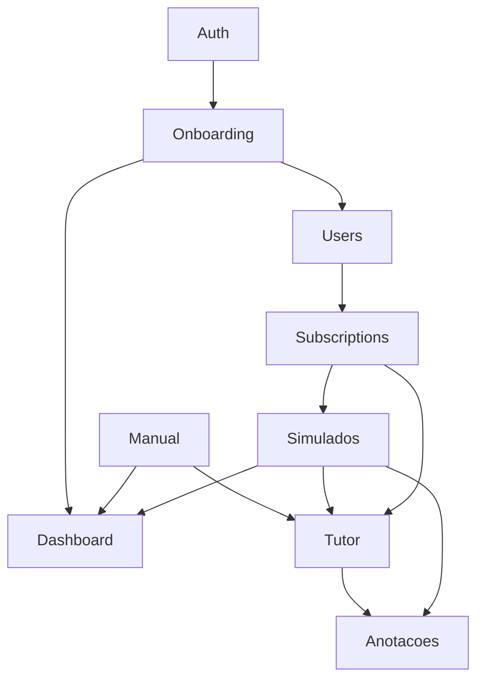

# ATO Backend — Roadmap de Desenvolvimento

**Versão:** 1.0 — Abril 2026  
**Stack:** Node.js 20 + TypeScript strict + Fastify 4 + Prisma 5 + PostgreSQL (Supabase) + Redis (Upstash)  
**Referências:** `ATO_Especificacao_Sistema.txt` (v5.0), `ATO_ArquiteturaIA_MVP.txt`, `ATO_Stack_Infraestrutura_v1.0.txt`, `ATO_Free_vs_PRO.txt`

> Este documento é o briefing técnico de desenvolvimento do backend. Cada bloco de módulo é **autocontido** — o dev responsável por aquele bloco não precisa ler os outros para iniciar. Siga a ordem de sprints, pois as dependências entre módulos são sequenciais.

---

## 0. Estado Atual (baseline pós-consolidação)

### Módulos e status

| Módulo | Arquivo principal | Status |
|--------|------------------|--------|
| Auth | `src/modules/auth/` | **Completo** |
| Lexia (M4) | `src/modules/tutor-ia/` | **Completo** — loop agêntico, adapters, tools, rate limit, Redis |
| Subscriptions | `src/modules/subscriptions/` | **Completo** — webhook RevenueCat, status PRO |
| Onboarding (M1) | `src/modules/onboarding/` | Esqueleto — falta endpoints do Quiz Diagnóstico e retorno com flow A/B |
| Dashboard (M2) | `src/modules/dashboard/` | Esqueleto — falta dailyProgress, oabMode, revision cards, performance hub |
| Manual (M3) | `src/modules/manual/` | Esqueleto — falta rastreamento de leitura, progresso por matéria, busca unificada |
| Anotações (M6) | `src/modules/anotacoes/` | Esqueleto — falta campos title/tags/subject, busca, filtros |
| Users | `src/modules/users/` | Esqueleto — falta academicPhase no update, lógica de toggle OAB |
| Simulados (M5) | `src/modules/simulados/` | Esqueleto — falta ciclo de vida completo, limites Free, features PRO |

### Dados disponíveis em banco

- **`legal_articles`** — 18.779 registros (CF/88, CC, CP, CLT, CPC, CPP, CTN, CDC, Estatuto OAB). BM25 com `portuguese_unaccent` ativo. Fora do Prisma — acessado via `$queryRaw`.
- **Schema Prisma migrado** com modelos: `User`, `Profile`, `StudyPlan`, `Subscription`, `Topic`, `TutorSession`, `TutorMessage`, `Question`, `SimuladoAttempt`, `SimuladoQuestion`, `Annotation`, `UserQuestionAnswered`.
- **Sem questões** no banco ainda — pré-requisito externo (time de dados).

### Infraestrutura já configurada

- Fastify com Helmet, CORS (via `CORS_ORIGIN`), JWT Supabase, rate limit global 200 req/min
- Error handler global: `AppError` → JSON `{ error, message, statusCode }`
- Sentry inicializado condicionalmente por `SENTRY_DSN`
- Redis Upstash: namespaces `tutor:session:*`, `tutor:rate:*`, `tutor:tokens:*`
- `requireAuth` middleware: JWT verify + auto-provision `User + Profile + Subscription(free)` no primeiro acesso

---

## 1. Mapa de Dependências entre Módulos



**Regra:** nenhum módulo deve ser iniciado antes de seus pré-requisitos estarem com critério de aceite atingido.

---

## 2. Sprint 1 — Fundação Funcional

**Objetivo:** todos os fluxos do plano Free funcionam end-to-end. O usuário consegue se cadastrar, completar o onboarding, ler conteúdo do Manual, usar a Lexia e criar anotações.

**Pré-requisito global:** Auth já completo. `prisma migrate dev` rodado com o schema atual.

---

### Sprint 1 · M1 — Onboarding

> **Decisão de design (Maio 2026):** o onboarding foi simplificado para uma única tela com duas perguntas. A abordagem de 4 steps separados foi descartada. O Quiz Diagnóstico é universal (todos os perfis) mas opcional — persiste como banner até o usuário concluir ou dispensar conscientemente.

#### Contexto

O onboarding coleta apenas o mínimo necessário para gerar um plano de estudos real: fase acadêmica e tempo disponível por dia. Tudo mais (matérias de dificuldade, objetivo) é capturado via comportamento do usuário dentro do app ao longo do tempo.

Após o onboarding, **todos** os usuários recebem a oferta do Quiz Diagnóstico, com dois caminhos de questões:
- **`oab`** — questões em nível OAB, calibra o candidato em relação ao exame real
- **`graduation`** — questões em múltiplos níveis, calibra o estudante dentro da grade acadêmica

O quiz é opcional. O banner persiste na Home até o usuário concluir (`diagnostic/complete`) ou dispensar conscientemente (`diagnostic/dismiss`). Um dismiss não é um skip acidental — o frontend exige confirmação explícita do usuário antes de chamar esse endpoint.

#### Pré-requisito

Nenhum além do Auth.

#### Schema Prisma — campos a alterar em `Profile`

```prisma
// Campos existentes que mudam de comportamento:
onboardingStep    Int     // Não mais usado para navegação multi-step.
                          // Setado como 1 quando onboarding concluído. Manter por compatibilidade.
nivelamentoPendente Boolean @default(false)  // Agora universal — setado true para TODOS ao concluir onboarding

// Campos novos a adicionar:
nivelamentoConcluido Boolean @default(false) @map("nivelamento_concluido")
// true = usuário completou o quiz | false = pendente ou dispensado
// Distingue conclusão real de dismiss para analytics e qualidade de personalização

nivelamentoPath String? @map("nivelamento_path")
// "oab" | "graduation" — determinado por academicPhase no onboarding/complete
// Define qual banco de questões o frontend solicita para o quiz
```

`academicPhase` agora aceita 4 valores válidos: `graduation_start`, `graduation_mid`, `graduation_end`, `oab_prep`.

Rodar `prisma migrate dev` após adicionar os dois campos novos.

#### Entregáveis funcionais

- `POST /onboarding/complete` — recebe `academicPhase` + `dailyStudyMins`, gera plano, seta `nivelamentoPendente: true` para todos
- `POST /onboarding/diagnostic/complete` — marca quiz concluído (`nivelamentoPendente: false`, `nivelamentoConcluido: true`)
- `POST /onboarding/diagnostic/dismiss` — dispensa conscientemente (`nivelamentoPendente: false`, `nivelamentoConcluido` permanece `false`)

#### Contratos de API

```
POST /onboarding/complete
Auth: JWT
Body: {
  academicPhase: "graduation_start" | "graduation_mid" | "graduation_end" | "oab_prep",
  dailyStudyMins: 30 | 60 | 120 | 180
}
Response 200: {
  done: true,
  flow: "graduation" | "oab",
  nivelamentoPendente: true,
  nivelamentoPath: "graduation" | "oab",
  studyPlan: { id, durationDays, dailyMins }
}

POST /onboarding/diagnostic/complete
Auth: JWT
Body: (vazio)
Response 200: { nivelamentoPendente: false, nivelamentoConcluido: true }

POST /onboarding/diagnostic/dismiss
Auth: JWT
Body: (vazio)
Response 200: { nivelamentoPendente: false, nivelamentoConcluido: false }
```

#### Regras de negócio

| Regra | Detalhe |
|-------|---------|
| `flow: "graduation"` | `academicPhase` ∈ `graduation_start`, `graduation_mid`, `graduation_end` |
| `flow: "oab"` | `academicPhase === "oab_prep"` |
| `nivelamentoPath` | Igual ao `flow` — determina qual banco de questões o frontend solicita |
| `nivelamentoPendente: true` | Setado para **todos** os usuários ao concluir `onboarding/complete` |
| `durationDays` por fase | `graduation_start` → 180d · `graduation_mid` → 120d · `graduation_end` → 90d · `oab_prep` → 90d |
| `diagnostic/complete` | `nivelamentoPendente: false` + `nivelamentoConcluido: true` |
| `diagnostic/dismiss` | `nivelamentoPendente: false` · `nivelamentoConcluido` permanece `false` |
| Idempotência | Chamar `complete` ou `dismiss` em sequência não gera erro — apenas atualiza o estado |
| `onboardingStep` | Setado como `1` ao concluir `onboarding/complete`. Não usado para navegação. |

#### Arquivos a tocar

| Arquivo | O que recebe |
|---------|-------------|
| `prisma/schema.prisma` | Campos `nivelamentoConcluido` e `nivelamentoPath` em `Profile` |
| `src/modules/onboarding/onboarding.service.ts` | `complete()` recebe body com `academicPhase` + `dailyStudyMins`, seta `nivelamentoPendente: true` para todos, calcula `nivelamentoPath`; novo `dismissQuiz()`; `completeQuiz()` seta `nivelamentoConcluido: true` |
| `src/modules/onboarding/onboarding.controller.ts` | Schema Zod do body do `complete`; handler `dismissQuiz` |
| `src/modules/onboarding/onboarding.routes.ts` | `POST /diagnostic/dismiss` (substitui `skip`) |

#### Critério de aceite

- [ ] `POST /onboarding/complete` com `graduation_start` retorna `flow: "graduation"`, `nivelamentoPath: "graduation"`, `nivelamentoPendente: true`
- [ ] `POST /onboarding/complete` com `oab_prep` retorna `flow: "oab"`, `nivelamentoPath: "oab"`, `nivelamentoPendente: true`
- [ ] `POST /onboarding/complete` com `graduation_end` + `dailyStudyMins: 60` persiste `academicPhase` e gera plano com `durationDays: 90`
- [ ] `POST /onboarding/diagnostic/complete` seta `nivelamentoPendente: false` e `nivelamentoConcluido: true` no DB
- [ ] `POST /onboarding/diagnostic/dismiss` seta `nivelamentoPendente: false` e mantém `nivelamentoConcluido: false`
- [ ] Chamar `dismiss` após `complete` não altera `nivelamentoConcluido: true` (idempotência)

---

### Sprint 1 · M2 — Dashboard

#### Contexto

O `GET /dashboard` retorna hoje apenas `name`, `plan`, `streak` e `recentAttempts`. Faltam os dados que alimentam todas as seções da T10: meta diária, oabMode, banner de nivelamento, revisão inteligente e hub de desempenho.

#### Pré-requisito

M1 Onboarding concluído (campo `nivelamentoPendente` e `academicPhase` populados).

#### Entregáveis funcionais

- `GET /dashboard` retorna dados completos da Home (T10): streak, dailyProgress, oabMode, nivelamentoPendente
- `GET /dashboard/revision-cards` retorna 6+ cards de revisão priorizados por taxa de erro (RF22)
- `GET /dashboard/performance` retorna hub de desempenho com métricas globais e breakdown por disciplina (T15)

#### Contratos de API

```
GET /dashboard
Auth: JWT
Response 200: {
  name: string,
  plan: "free" | "pro",
  oabMode: boolean,
  nivelamentoPendente: boolean,
  streak: { current: number, longest: number },
  dailyProgress: {
    questionsAnsweredToday: number,
    topicsReadToday: number,
    dailyGoalMins: number
  }
}

GET /dashboard/revision-cards
Auth: JWT
Response 200: {
  cards: [
    {
      subject: string,
      lawCode: string,
      errorRate: number,       // 0.0–1.0
      totalAnswered: number,
      priority: "high" | "scheduled"
    }
  ]
}

GET /dashboard/performance
Auth: JWT
Response 200: {
  totalAnswered: number,
  globalAccuracyRate: number,   // 0.0–1.0
  oabBaseline: 0.60,            // hardcoded
  bySubject: [
    { subject: string, answered: number, correct: number, accuracyRate: number }
  ]
}
```

#### Regras de negócio

| Regra | Referência |
|-------|-----------|
| `oabMode: true` quando `academicPhase === "oab_prep"` | T10, T23 |
| `nivelamentoPendente` alimenta o banner condicional na Home | RF14, T10 |
| `questionsAnsweredToday` — conta `SimuladoQuestion` com `answeredAt >= hoje 00:00` e `studentAnswer NOT NULL` | RF20 |
| `topicsReadToday` — conta `TopicRead` com `readAt >= hoje 00:00` (model criado no M3) | RF20 |
| `revision-cards` — agrupa `SimuladoQuestion` por `question.subject` das últimas 2 semanas, calcula `errorRate = erros/total`, retorna mínimo 6, ordenado por `errorRate DESC` | RF22 |
| `priority: "high"` quando `errorRate > 0.5`; `"scheduled"` caso contrário | RF22 |
| Médias OAB são hardcoded em `0.60` no MVP | RF56 |
| Fins de semana não quebram nem incrementam streak | RF21 |

#### Arquivos a tocar

| Arquivo | O que recebe |
|---------|-------------|
| `src/modules/dashboard/dashboard.service.ts` | `getHomeData()` expandido; novo `getRevisionCards(userId)`; novo `getPerformanceHub(userId)` |
| `src/modules/dashboard/dashboard.controller.ts` | Handlers `getRevisionCards` e `getPerformance` |
| `src/modules/dashboard/dashboard.routes.ts` | `GET /revision-cards` e `GET /performance` |

#### Nota sobre TopicRead

`topicsReadToday` depende do model `TopicRead` que será criado no M3. Enquanto M3 não estiver concluído, retornar `topicsReadToday: 0` sem quebrar o endpoint.

#### Critério de aceite

- [ ] `GET /dashboard` retorna todos os campos do contrato
- [ ] `oabMode: true` somente para usuários com `academicPhase === "oab_prep"`
- [ ] `GET /dashboard/revision-cards` retorna mínimo 6 cards (pode retornar vazio se não houver histórico)
- [ ] `GET /dashboard/performance` retorna `bySubject` com todos os subjects que o usuário já respondeu

---

### Sprint 1 · M3 — Manual do Direito

#### Contexto

Os endpoints de listagem, leitura e busca existem. Faltam:

1. Rastreamento de leitura de tópicos (model `TopicRead`)
2. Progresso de leitura por matéria retornado na listagem
3. Flag `isRead` por tópico no detalhe
4. Busca unificada (topics + legal_articles)

#### Pré-requisito

Nenhum além do Auth. Mas `TopicRead` alimenta `topicsReadToday` do Dashboard — conclua M3 antes de finalizar M2.

#### Entregáveis funcionais

- `POST /manual/topics/:id/read` — marca tópico como lido (idempotente)
- `GET /manual/topics` — retorna progresso de leitura por `lawCode`
- `GET /manual/topics/:id` — inclui `isRead: boolean` para o usuário atual
- `GET /manual/search` — resultado unificado de `topics` + `legal_articles` com campo `source`

#### Schema Prisma — novo model

```prisma
model TopicRead {
  id        String   @id @default(uuid())
  userId    String   @map("user_id")
  topicId   String   @map("topic_id")
  readAt    DateTime @default(now()) @map("read_at")

  user  User  @relation(fields: [userId], references: [id], onDelete: Cascade)
  topic Topic @relation(fields: [topicId], references: [id], onDelete: Cascade)

  @@unique([userId, topicId])
  @@index([userId])
  @@map("topic_reads")
}
```

Adicionar relação em `User`: `topicReads TopicRead[]`  
Adicionar relação em `Topic`: `reads TopicRead[]`  
Rodar `prisma migrate dev` após adicionar o model.

#### Contratos de API

```
POST /manual/topics/:id/read
Auth: JWT
Body: (vazio)
Response 200: { topicId: string, readAt: string, isNew: boolean }

GET /manual/topics?lawCode=CC
Auth: JWT
Response 200: [
  {
    id, code, title, lawCode, chapter, order, isPro,
    progress: { readCount: number, totalTopics: number }
  }
]
(progress é por lawCode, não por tópico individual)

GET /manual/topics/:id
Auth: JWT
Response 200: { id, code, title, lawCode, content, order, isPro, isRead: boolean }

GET /manual/search?q=responsabilidade+civil&lawCode=CC
Auth: JWT
Response 200: {
  results: [
    {
      source: "topic",
      id: string,
      title: string,
      lawCode: string,
      snippet: string
    } | {
      source: "article",
      lawCode: string,
      articleNumber: string,
      fullReference: string,
      content: string,
      score: number
    }
  ]
}
```

#### Regras de negócio

| Regra | Referência |
|-------|-----------|
| Marcar como lido é idempotente — upsert, nunca duplica | RF34 |
| Leitura **não** conta para o streak do usuário | RF21, RF35 |
| Leitura alimenta `topicsReadToday` do Dashboard (M2) | RF20 |
| Progresso de matéria = `readCount / totalTopics` para o `lawCode` | T11, T12 |
| Busca retorna máximo 10 artigos de `legal_articles` + máximo 5 tópicos de `topics` | RF32 |
| Busca em `topics`: ILIKE em `title` e `content` | RF32 |
| Busca em `legal_articles`: BM25 com `plainto_tsquery('portuguese_unaccent', q)` (já implementado) | RF32, RF41 |

#### Arquivos a tocar

| Arquivo | O que recebe |
|---------|-------------|
| `prisma/schema.prisma` | Model `TopicRead`; relações em `User` e `Topic` |
| `src/modules/manual/manual.service.ts` | `markAsRead(userId, topicId)`; `listTopics()` expandido com progress; `getTopic(id, userId)` com `isRead`; `search()` unificado |
| `src/modules/manual/manual.controller.ts` | Handler `markAsRead`; `getTopic` recebe `userId`; `listTopics` recebe `userId` |
| `src/modules/manual/manual.routes.ts` | `POST /topics/:id/read` |

#### Critério de aceite

- [ ] `POST /manual/topics/:id/read` chamado duas vezes não duplica registro
- [ ] `GET /manual/topics` retorna `progress.readCount` correto para o usuário
- [ ] `GET /manual/topics/:id` retorna `isRead: true` após marcar como lido
- [ ] `GET /manual/search?q=contrato` retorna resultados de ambas as fontes com campo `source`

---

### Sprint 1 · M6 — Anotações

#### Contexto

CRUD básico funciona (`content`, `topicId`, `lawCode`, `articleRef`, `highlight`). Faltam os campos da spec T19/T20 (`title`, `tags`, `subject`) e a busca/filtros.

#### Pré-requisito

Nenhum além do Auth.

#### Entregáveis funcionais

- CRUD completo com `title`, `tags`, `subject`
- `GET /annotations` com filtros por `subject`, `tag` e busca por `q`
- `PUT /annotations/:id` atualiza todos os campos, não apenas `content`

#### Schema Prisma — campos a adicionar em `Annotation`

```prisma
title   String?  // título da anotação (T20)
tags    Json?    @map("tags")     // string[] — tags personalizadas (RF71)
subject String?  @map("subject")  // matéria associada, ex: "Constitucional" (RF71)
```

Rodar `prisma migrate dev` após adicionar os campos.

#### Contratos de API

```
GET /annotations?topicId=&subject=Constitucional&tag=boa-fe&q=contrato
Auth: JWT
Response 200: [
  {
    id, userId, topicId, lawCode, articleRef,
    title, content, highlight, tags, subject,
    createdAt, updatedAt
  }
]

POST /annotations
Auth: JWT
Body: {
  topicId?: string,
  lawCode?: string,
  articleRef?: string,
  content: string (min 1),
  highlight?: string,
  title?: string,
  tags?: string[],
  subject?: string
}
Response 201: { ...annotation }

PUT /annotations/:id
Auth: JWT
Body: {
  content?: string,
  title?: string,
  tags?: string[],
  subject?: string,
  lawCode?: string,
  articleRef?: string
}
Response 200: { ...annotation }

DELETE /annotations/:id
Auth: JWT
Response 204
```

#### Regras de negócio

| Regra | Referência |
|-------|-----------|
| Listagem ordenada por `updatedAt DESC` | T19 |
| Filtros `subject` e `tag` são combinados por AND | T19 |
| Filtro `tag` busca dentro do array JSON: `tags @> '["valor"]'` via `$queryRaw` ou Prisma raw | RF71 |
| Busca `q` aplica ILIKE em `title` e `content` | RF72 |
| Exclusão requer pertencer ao usuário (verificar `userId` antes de deletar) | RF70 |
| Anotação sem `title` exibe prévia do `content` como identificador no Flutter (lógica no cliente) | T19 |
| Compartilhamento com Lexia via consentimento LGPD — fora do escopo MVP, sem endpoint agora | RF73, RF74 |

#### Arquivos a tocar

| Arquivo | O que recebe |
|---------|-------------|
| `prisma/schema.prisma` | Campos `title`, `tags`, `subject` em `Annotation` |
| `src/modules/anotacoes/anotacoes.service.ts` | `create()` e `update()` aceitam novos campos; `list()` com filtros `subject`, `tag`, `q` |
| `src/modules/anotacoes/anotacoes.controller.ts` | Schemas Zod atualizados com novos campos; query params do `list` |
| `src/modules/anotacoes/anotacoes.routes.ts` | Sem novos endpoints — só `GET /` precisa aceitar query params adicionais |

#### Critério de aceite

- [ ] `POST /annotations` com `title`, `tags: ["lgpd","prova"]`, `subject: "Constitucional"` persiste todos os campos
- [ ] `GET /annotations?subject=Constitucional` retorna apenas anotações dessa matéria
- [ ] `GET /annotations?tag=prova` retorna apenas anotações com essa tag
- [ ] `GET /annotations?q=personalidade` busca em `title` e `content`
- [ ] `PUT /annotations/:id` atualiza `tags` sem perder `subject`

---

### Sprint 1 · M — Users / Perfil

#### Contexto

`GET /users/profile` e `PUT /users/profile` existem. Falta:

1. `PUT /users/profile` aceitar `academicPhase` (toggle OAB mode, T21)
2. Quando muda para `oab_prep`, setar `nivelamentoPendente: true` se o quiz não foi feito
3. `getProfile()` expõe `nivelamentoPendente` explicitamente no retorno

#### Pré-requisito

M1 Onboarding concluído (campo `nivelamentoPendente` em uso).

#### Entregáveis funcionais

- `PUT /users/profile` aceita `academicPhase` e aplica a lógica de nivelamento
- `GET /users/profile` retorna `nivelamentoPendente` no response

#### Contratos de API

```
GET /users/profile
Auth: JWT
Response 200: {
  id, userId, name, avatarUrl,
  academicPhase, dailyStudyMins, selectedSubjects,
  onboardingDone,
  nivelamentoPendente,
  nivelamentoConcluido,
  nivelamentoPath,
  streakDays, longestStreak, lastStudyDate,
  notifEnabled, notifTime, oneSignalPlayerId,
  createdAt, updatedAt
}

PUT /users/profile
Auth: JWT
Body: {
  name?: string,
  avatarUrl?: string (url),
  academicPhase?: "graduation_start" | "graduation_mid" | "graduation_end" | "oab_prep"
}
Response 200: { ...profile }
```

#### Regras de negócio

| Regra | Referência |
|-------|-----------|
| Mudar `academicPhase` → atualizar `nivelamentoPath`: `"oab"` se novo valor for `oab_prep`, `"graduation"` para os demais | T21 |
| `nivelamentoPendente` **não é alterado** pela troca de `academicPhase` — foi setado universalmente no onboarding e só muda via `/diagnostic/complete` ou `/diagnostic/dismiss` | T21, RF14 |
| `graduation_end` é um valor válido de `academicPhase` — mesma duração de plano que `oab_prep` (90 dias) | Design 2026-05 |
| Troca de senha → responsabilidade do Supabase Auth (SDK Flutter). Sem endpoint no backend ATO | T21 |
| Upload de foto de perfil → `avatarUrl` recebe URL já hospedada (Supabase Storage via Flutter). Sem upload direto no backend | T21 |

#### Arquivos a tocar

| Arquivo | O que recebe |
|---------|-------------|
| `src/modules/users/users.service.ts` | `updateProfile()` aceita `academicPhase`; lógica de `nivelamentoPendente`; `getProfile()` sem alteração de query (já retorna tudo) |
| `src/modules/users/users.controller.ts` | Schema Zod do `PUT /profile` inclui `academicPhase` |

#### Critério de aceite

- [ ] `PUT /users/profile` com `academicPhase: "oab_prep"` seta `nivelamentoPendente: true` no DB
- [ ] `PUT /users/profile` com `academicPhase: "graduation_start"` não altera `nivelamentoPendente`
- [ ] `GET /users/profile` retorna `nivelamentoPendente` no JSON

---

## 3. Sprint 2 — Simulados Completos

**Objetivo:** M5 totalmente funcional — fluxo completo do ciclo de vida, limites Free, features PRO, rastreamento de questões respondidas.

**Pré-requisito:** Sprint 1 concluído. Banco de questões disponibilizado pelo time de dados.

---

### Sprint 2 · M5 — Simulados

#### Contexto

Existe: start, answer, complete, results, history, seleção aleatória por `ORDER BY random()`, `status: 'completed'` no complete.

Falta:
1. Estado "Iniciado" — abandon e listagem `in_progress`
2. Rastreamento de questões respondidas em `UserQuestionAnswered`
3. Limite diário de 15 questões para Free (Redis)
4. Limite de 20 questões por simulado para Free
5. Modo `weak_areas` (PRO)
6. "Questões inéditas" (PRO)
7. Diferenciação de resposta por plano em `getResults`

#### Pré-requisito

Sprint 1 concluído. Redis configurado (já está). `UserQuestionAnswered` model já existe no schema.

#### Entregáveis funcionais

- `POST /simulados/:id/abandon` — seta `status: 'abandoned'`
- `GET /simulados/in-progress` — retorna simulado(s) em andamento do usuário
- `submitAnswer()` — popula `UserQuestionAnswered` por upsert
- Limites Free aplicados no `startAttempt()` e no `submitAnswer()`
- Modo `weak_areas` disponível para PRO
- Opção `excludeAnswered` disponível para PRO
- `getResults()` diferencia campos por plano

#### Contratos de API

```
GET /simulados/in-progress
Auth: JWT
Response 200: {
  attempts: [
    {
      id, mode, status, totalQ, subjects,
      questionsAnswered: number,
      startedAt
    }
  ]
}

POST /simulados/:id/abandon
Auth: JWT
Body: (vazio)
Response 200: { id, status: "abandoned" }

POST /simulados/start
Auth: JWT
Body: {
  mode: "custom" | "oab_phase1" | "weak_areas",
  subject?: string,          // obrigatório quando mode === "custom"
  subjects?: string[],       // disciplinas para filtro
  totalQ: number (5–80),
  excludeAnswered?: boolean  // PRO apenas
}
Response 200: { id, mode, status: "in_progress", totalQ, questions: [...] }

POST /simulados/:id/answer
Auth: JWT
Body: { questionId, answer: "A"|"B"|"C"|"D", timeSpentSecs? }
Response 200: { isCorrect: boolean, correctAnswer: string }
(PRO adiciona: explanation?: string)

GET /simulados/:id/results
Auth: JWT
Response 200: {
  id, score, totalQ, correctQ, completedAt,
  questions: [
    {
      id, order, studentAnswer, isCorrect, correctAnswer,
      question: { statement, options, subject, board, year,
                  explanation?: string }  // PRO apenas
    }
  ]
}
```

#### Regras de negócio

| Regra | Referência |
|-------|-----------|
| Free: máximo 20 questões por simulado (`totalQ ≤ 20`). Retornar `400` se exceder | T16 |
| Free: máximo 15 questões respondidas por dia. Contador Redis `simulado:daily:{userId}` TTL 24h. Retornar `429` ao exceder | ATO_Free_vs_PRO |
| `weak_areas` (PRO): calcular as 3 disciplinas com menor taxa de acerto nos últimos 60 dias em `SimuladoQuestion`. Usar esses subjects no filtro do `ORDER BY random()` | RF57, T23 |
| `excludeAnswered` (PRO): excluir questões presentes em `UserQuestionAnswered` do usuário no `$queryRaw` | RF58 |
| `submitAnswer` sempre faz upsert em `UserQuestionAnswered` — ignora conflito unique | RF58 |
| `status: 'abandoned'` não preenche `completedAt` nem `score` | T17, T23 |
| Máximo 1 simulado `in_progress` por usuário (constraint de negócio). Ao iniciar novo com outro `in_progress`, retornar `409 CONFLICT` com `{ error: "SIMULADO_IN_PROGRESS", inProgressId: "uuid" }` | T23 |
| `explanation` em `getResults` — retornar apenas para usuários PRO (`isPro: true` verificado no controller via `db.subscription`) | T24, ATO_Free_vs_PRO |

#### Redis — novo namespace

```
simulado:daily:{userId}  TTL: 24h (86400s)  Tipo: counter (incr)
```

#### Arquivos a tocar

| Arquivo | O que recebe |
|---------|-------------|
| `src/modules/simulados/simulados.service.ts` | `abandonAttempt()`; `listInProgress()`; `submitAnswer()` com upsert em `UserQuestionAnswered` e contador Redis; `startAttempt()` com limites Free, weak_areas, excludeAnswered; `getResults()` com parâmetro `isPro` |
| `src/modules/simulados/simulados.controller.ts` | Handlers `abandon` e `inProgress`; `start` com `excludeAnswered`; `getResults` lê plano e passa `isPro` |
| `src/modules/simulados/simulados.routes.ts` | `POST /:id/abandon`; `GET /in-progress` |
| `src/shared/redis.ts` | Adicionar chave `simuladoDaily: (userId) => \`simulado:daily:\${userId}\`` ao objeto `keys` |

#### Critério de aceite

- [ ] `POST /simulados/start` com usuário Free e `totalQ: 30` retorna `400`
- [ ] Responder 15 questões com usuário Free retorna `429` na 16ª
- [ ] `POST /simulados/:id/abandon` seta `status: 'abandoned'`, sem `completedAt`
- [ ] `GET /simulados/in-progress` retorna o simulado iniciado
- [ ] `POST /simulados/start` com outro simulado `in_progress` retorna `409`
- [ ] `UserQuestionAnswered` é populado após `submitAnswer`
- [ ] `GET /simulados/:id/results` com Free não retorna campo `explanation`
- [ ] `GET /simulados/:id/results` com PRO retorna `explanation` em cada questão

---

## 4. Sprint 3 — PRO Features & Monetização

**Objetivo:** todas as features PRO operacionais. RevenueCat ativo após decisão de pricing.

**Pré-requisito:** Sprint 2 concluído. Decisão de pricing do time de produto.

---

### Sprint 3 · M4 — Lexia (gaps PRO)

#### Contexto

O loop agêntico, adapters, tools, rate limit e session Redis estão completos. Faltam:

1. `chips` não é retornado no response (estão definidos em `chips.config.ts` mas nunca enviados)
2. Ao deletar sessão (`DELETE /tutor/session/:id`), o histórico Redis é apagado sem persistir no DB
3. Feature PRO: "Criar card com resumo" — auto-save de resposta com `confidence: "high"` como anotação

#### Pré-requisito

M6 Anotações concluído (para o auto-save). Subscriptions funcionando.

#### Entregáveis funcionais

- `POST /tutor/message` inclui `chips` e `autoSavedAnnotationId` (PRO) no response
- `DELETE /tutor/session/:id` persiste `TutorSession` + `TutorMessage[]` no DB antes de limpar Redis
- Feature PRO "Criar card" ativa automaticamente após resposta com `confidence: "high"`

#### Contratos de API

```
POST /tutor/message
Response 200: {
  message: string,
  sources: [...],
  confidence: "high" | "medium" | "low",
  disclaimer?: string,
  mode: string,
  chips: ["Explique com um exemplo", "Como isso cai na OAB?", "Qual a base legal?", "Simplifique para mim"],
  autoSavedAnnotationId?: string   // PRO — presente apenas quando confidence === "high" e isPro
}
```

#### Regras de negócio

| Regra | Referência |
|-------|-----------|
| `chips` são sempre os 4 estáticos de `chips.config.ts`, em toda resposta | RF42 |
| Auto-save PRO: `confidence === "high"` E `isPro: true` → criar anotação com `title = primeiros 60 chars da mensagem`, `content = response.message`, `subject = derivado do contexto (topic_title ou question_bundle.subject)` | ATO_Free_vs_PRO |
| Persistência de sessão: no `DELETE`, salvar `TutorSession` com `endedAt = now()` e `msgCount`, e `TutorMessage[]` com `role`, `content`, `sources` | Analytics interno |

#### Arquivos a tocar

| Arquivo | O que recebe |
|---------|-------------|
| `src/modules/tutor-ia/controllers/tutor.controller.ts` | `sendMessage()` — anexa `chips` e `autoSavedAnnotationId` ao retorno |
| `src/modules/tutor-ia/services/tutor.service.ts` | `chat()` — lógica de auto-save quando PRO e confidence high |
| `src/modules/tutor-ia/controllers/tutor.controller.ts` | `deleteSession()` — chama novo método de persistência antes de `sessionSvc.clear()` |
| `src/modules/tutor-ia/services/session.service.ts` | Novo método `persistToDB(sessionId, userId, mode)` — salva TutorSession e TutorMessage[] |

#### Critério de aceite

- [ ] `POST /tutor/message` sempre retorna `chips` com os 4 valores do `chips.config.ts`
- [ ] Com usuário PRO e resposta `confidence: "high"`, `autoSavedAnnotationId` é retornado e a anotação existe no DB
- [ ] `DELETE /tutor/session/:id` cria registro em `TutorSession` com `endedAt` preenchido

---

### Sprint 3 · Subscriptions — Hardening

#### Contexto

O webhook processa `INITIAL_PURCHASE`, `RENEWAL`, `CANCELLATION`, `EXPIRATION`. Faltam:

1. Evento `UNCANCELLATION` — RevenueCat o emite quando o usuário volta antes do vencimento
2. `CANCELLATION` e `EXPIRATION` não fazem downgrade do `plan` para `"free"` — apenas atualizam `status`
3. Sem logging dos eventos (crítico para debugging de pagamento em produção)

#### Entregáveis funcionais

- Todos os eventos RevenueCat relevantes tratados corretamente
- Downgrade de `plan: "pro"` para `plan: "free"` em `CANCELLATION`/`EXPIRATION`
- Log estruturado de cada evento recebido

#### Regras de negócio

| Evento RevenueCat | Ação no DB |
|-------------------|-----------|
| `INITIAL_PURCHASE` | `plan: "pro"`, `status: "active"`, `activatedAt`, `expiresAt` |
| `RENEWAL` | `plan: "pro"`, `status: "active"`, `expiresAt` atualizado |
| `CANCELLATION` | `status: "cancelled"` — `plan` permanece `"pro"` até `expiresAt` |
| `EXPIRATION` | `plan: "free"`, `status: "expired"` — downgrade efetivo |
| `UNCANCELLATION` | `plan: "pro"`, `status: "active"` — reativa |

**Nota:** no `CANCELLATION`, o usuário mantém acesso PRO até `expiresAt`. O downgrade real (`plan: "free"`) acontece apenas no `EXPIRATION`.

#### Arquivos a tocar

| Arquivo | O que recebe |
|---------|-------------|
| `src/modules/subscriptions/subscriptions.service.ts` | Case `UNCANCELLATION`; `EXPIRATION` seta `plan: "free"`; `CANCELLATION` não muda `plan` |
| `src/modules/subscriptions/subscriptions.controller.ts` | Log estruturado `app.log.info({ event: event.type, userId })` antes de processar |

#### Critério de aceite

- [ ] `EXPIRATION` seta `plan: "free"` no DB
- [ ] `CANCELLATION` mantém `plan: "pro"` (apenas muda status)
- [ ] `UNCANCELLATION` reativa com `plan: "pro"` e `status: "active"`
- [ ] Todo webhook logado com `event.type` e `app_user_id`

---

### Sprint 3 · Push Notifications (OneSignal)

#### Contexto

O campo `oneSignalPlayerId` já existe em `Profile`. Falta o service de notificações e a validação do player ID.

#### Pré-requisito

`ONESIGNAL_APP_ID` e `ONESIGNAL_API_KEY` configurados no Railway.

#### Entregáveis funcionais

- `shared/notifications.service.ts` — wrapper da OneSignal REST API
- `PUT /users/notifications` valida o player ID antes de salvar
- Documentação do cron de streak reminder (implementado fora do backend)

#### Contratos internos

```typescript
// shared/notifications.service.ts
class NotificationsService {
  async sendPush(
    playerId: string,
    title: string,
    body: string,
    data?: Record<string, string>
  ): Promise<{ success: boolean; error?: string }>
}
```

#### Regras de negócio

| Regra | Referência |
|-------|-----------|
| Validar `oneSignalPlayerId` via `GET /players/:id` da OneSignal API antes de salvar. Se inválido, retornar `400` | T21 |
| Se `ONESIGNAL_APP_ID` não estiver configurado, `sendPush()` loga aviso e retorna `{ success: false }` sem lançar exceção | Graceful degradation |
| Streak reminder cron — **fora do backend ATO**. Implementar como Railway Cron Job ou Supabase Edge Function que consulta `GET /dashboard/streak` e dispara via `NotificationsService` | T21 |

#### Arquivos a tocar

| Arquivo | O que recebe |
|---------|-------------|
| `src/shared/notifications.service.ts` | **Novo arquivo** — `sendPush()` wrapper OneSignal REST |
| `src/modules/users/users.service.ts` | `updateNotifications()` valida `oneSignalPlayerId` via OneSignal API antes de salvar |

#### Critério de aceite

- [ ] `NotificationsService.sendPush()` retorna `{ success: true }` com credenciais válidas
- [ ] Sem `ONESIGNAL_APP_ID`, não lança exceção
- [ ] `PUT /users/notifications` com player ID inválido retorna `400`

---

## 5. Sprint 4 — Hardening & Integração

**Objetivo:** backend production-ready. Suporte ao time de frontend para integração.

**Pré-requisito:** Sprints 1–3 concluídos.

---

### 5.1 Segurança e Validação

#### O que fazer

- Auditar todos os controllers: todo endpoint com query params ou body deve ter parse Zod explícito. Endpoints sem validação são risco de crash ou injeção
- Verificar que `requirePro` está aplicado antes dos handlers de: `weak_areas`, `excludeAnswered`, analysis pós-simulado, "criar card" do Tutor
- Rate limiting granular via `@fastify/rate-limit` por rota:
  - `POST /simulados/start` → 5 req/min por usuário
  - `POST /annotations` → 30 req/min por usuário
  - `POST /tutor/message` → já controlado por Redis (rate limit de negócio), mas adicionar rate limit de infra de 60 req/min

#### Arquivos a tocar

- Todos os controllers dos módulos do Sprint 1 e 2 (auditoria de Zod)
- `src/app.ts` ou rotas individuais para rate limit granular

---

### 5.2 Performance — Índices de DB

Adicionar ao `prisma/schema.prisma` antes do deploy final:

```prisma
// SimuladoQuestion — usada pesadamente pelo Dashboard (revision-cards, performance hub)
@@index([isCorrect])
@@index([answeredAt])

// Índice composto para getPerformanceHub
@@index([attemptId, isCorrect])
```

Rodar `prisma migrate dev` com a migration de índices.

---

### 5.3 Health Check com Connectivity

Expandir `GET /health` em `src/app.ts`:

```
GET /health
Response 200: {
  status: "ok" | "degraded",
  ts: string,
  db: "ok" | "error",
  redis: "ok" | "error"
}
```

- `db`: `await db.$queryRaw\`SELECT 1\`` — se falhar, `"error"`
- `redis`: `await redis.ping()` — se falhar, `"error"`
- Se qualquer componente estiver `"error"`, `status: "degraded"` (não `500` — o health endpoint sempre retorna `200` para não disparar restart loops)

---

### 5.4 API Contract Sync

Ao final do Sprint 4, `back/docs/api-contract.md` deve refletir todos os endpoints adicionados nos Sprints 1–3:

- `POST /onboarding/diagnostic/complete`
- `POST /onboarding/diagnostic/dismiss`
- `GET /dashboard/revision-cards`
- `GET /dashboard/performance`
- `POST /manual/topics/:id/read`
- `GET /simulados/in-progress`
- `POST /simulados/:id/abandon`

#### Entregável para o time de frontend

Ao entregar o Sprint 4, fornecer:

1. **Base URL de staging** (Railway) + credenciais de acesso
2. **`api-contract.md` atualizado** com todos os endpoints, bodies e responses
3. **Collection Postman/Insomnia** exportada com requests prontos e exemplos
4. **Credenciais de teste**: 1 usuário Free e 1 usuário PRO no ambiente de staging
5. **Documento de fluxos críticos** (pode ser seção adicional neste ROADMAP):
   - Auth flow: Supabase JWT → `/auth/verify` → `currentUser`
   - Onboarding fork: complete → `flow A/B` → diagnóstico
   - Tutor agentic loop: session → message → tool use → response
   - Simulado lifecycle: start → answer → complete/abandon

---

## 6. Decisões Externas Bloqueantes

| Decisão | Bloqueia | Quem decide | Status |
|---------|---------|-------------|--------|
| Pricing model PRO (mensal/anual/vitalício) | Sprint 3 — RevenueCat config, T22 | Time de produto | Pendente |
| Banco de questões (fonte, quantidade mínima, formato) | Sprint 2 — M5 com conteúdo real | Time de dados | Pendente |
| Critério de curadoria dos simulados prontos | Sprint 2 — T23 | Time de dados | Pendente |
| App IDs Apple/Google (para RevenueCat) | Sprint 3 — IAP config | Time mobile | Pendente |
| OneSignal App ID + API Key | Sprint 3 — Push | Setup de infra | Pendente |

**Regra:** não bloquear desenvolvimento por essas decisões. Construir com stubs e flags de feature que ativam quando a decisão chegar.

---

## 7. Convenções do Projeto

Leia esta seção antes de escrever qualquer código no backend ATO.

### Extraindo o usuário autenticado

```typescript
// Em qualquer controller, após preHandler: [requireAuth]
const user = (req as unknown as Record<string, unknown>).currentUser as { id: string };
```

### Lançando erros

Usar sempre a factory `Errors` de `src/shared/errors.ts`. Nunca lançar `new Error()` diretamente:

```typescript
import { Errors } from '../../shared/errors';

throw Errors.notFound('Tópico');       // 404
throw Errors.unauthorized();            // 401
throw Errors.forbidden();               // 403
throw Errors.conflict('Já respondida'); // 409
throw Errors.rateLimited('free');       // 429
throw Errors.proRequired();             // 403 PRO_REQUIRED
```

Para erros novos, adicionar à factory em `shared/errors.ts`.

### Validação Zod nos controllers

Todo input de usuário (body, query params, path params) deve ser parseado com Zod antes de usar:

```typescript
// Body
const body = MySchema.parse(req.body);

// Query params
const query = z.object({ q: z.string().min(2), limit: z.coerce.number().default(10) }).parse(req.query);

// Path params
const { id } = z.object({ id: z.string().uuid() }).parse(req.params);
```

### Middleware de auth vs PRO

```typescript
// Protege com JWT (qualquer usuário autenticado)
app.get('/rota', { preHandler: [requireAuth] }, handler);

// Protege com JWT + verifica plano PRO ativo
app.post('/rota-pro', { preHandler: [requireAuth, requirePro] }, handler);
```

`requirePro` lança `Errors.proRequired()` automaticamente se o plano não for PRO ativo.

### Redis — chaves e TTLs

```typescript
// src/shared/redis.ts — objeto keys
keys.tutorSession(sessionId)      // TTL: 4h    — histórico de chat
keys.tutorRateLimit(userId)       // TTL: 24h   — contador de mensagens/dia
keys.tutorTokenBudget(sessionId)  // TTL: 4h    — budget de tokens por sessão
// A adicionar no Sprint 2:
keys.simuladoDaily(userId)        // TTL: 24h   — contador de questões/dia (Free)
```

### Acesso a `legal_articles` (fora do Prisma)

Usar sempre `$queryRaw` com `Prisma.sql` para evitar SQL injection:

```typescript
import { Prisma } from '@prisma/client';

const rows = await db.$queryRaw<Row[]>(
  Prisma.sql`SELECT * FROM legal_articles WHERE law_code = ${lawCode} LIMIT 10`
);
```

### Padrão de retorno de listas

Todas as listagens retornam diretamente o array (sem wrapper `{ data: [], total: }`) por simplicidade no MVP. Paginação não está prevista no MVP — `take` fixo nos services.
